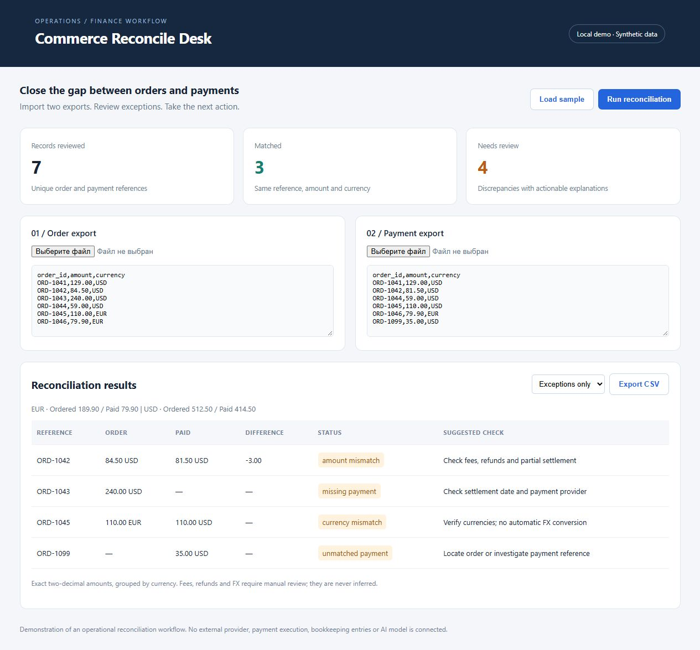

# Commerce Reconcile Desk

A small Python application for reconciling e-commerce order exports against payment settlements. Upload two CSV files, review mismatches and export a review queue with suggested checks.



## Run

Requires Python 3.10 or newer. No third-party packages, credentials or cloud services.

```sh
python server.py
```

Open http://127.0.0.1:8768. The dashboard starts with synthetic sample data. Replace it with your own CSV files or paste exports into the text areas.

```sh
python -m unittest -v
```

## Input contract

Both files use `order_id,amount,currency` columns. One row per order/payment reference; aggregate split payments before importing. Amounts are non-negative decimal values with at most two decimal places. Currency codes must have three ASCII letters. Duplicate references, malformed amounts and missing columns are rejected. Maximum 5,000 rows per file and 1 MB per request.

## Included

- Exact decimal arithmetic and separate totals per currency.
- Matched orders, missing payments, unmatched payments, amount and currency mismatches.
- Human-readable review actions; filter exceptions and export CSV.
- Spreadsheet formula neutralization for exported references and text-safe UI rendering.
- Sample exports covering every result type and regression tests.
- Local HTTP API: POST `/api/reconcile` or `/api/export`, with JSON `orders` and `payments` CSV strings.

## Scope

This is a deterministic workflow demo, not a bookkeeping system or AI product. It makes no journal entries, executes no payments and performs no FX conversion. Fees, taxes, refunds, settlement timing and split payments must be reviewed against the merchant's rules. There is no trained model or external LLM connection. A future grounded AI summary could explain detected discrepancies, with review before any action.

The server binds only to loopback and keeps submitted data in memory for a request. It has no authentication and must not be exposed as a public service. For production, add authorization, validated provider adapters, audit records, retention policy and deployment hardening. The demo supports two-decimal currencies only.
